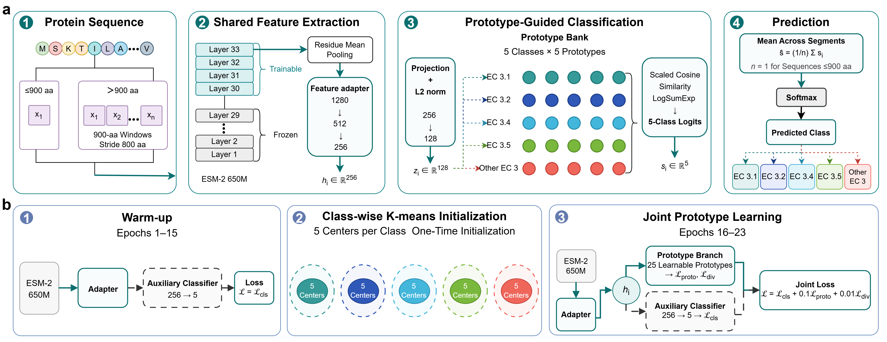

# HydroProto

[](https://doi.org/10.5281/zenodo.22020952)

Prototype-guided ESM-2 models for five-class bacterial hydrolase classification.



**Figure 1. HydroProto architecture and training workflow.** Protein sequences are
encoded with partially fine-tuned ESM-2 650M layers, projected into a compact
feature space, and classified with class-conditional online prototypes. Long
sequences are evaluated in overlapping windows and their predictions are averaged.

HydroProto represents each of five enzyme classes with five learnable prototypes
(25 prototypes in total). The repository also includes three controlled
comparators: **ESM2-MLP**, **HydroLocal**, and **HydroMPC**.

## Repository structure

```text
HydroProto/
|- hydroproto/       installable model and training code
|- configs/          experiment configuration examples
|- data/             fixed 2,721/680 train-test split
|- examples/         five-record sequence example
|- figures/          README and manuscript figures
|- models/           put downloaded task checkpoints here
|- results/          compact result tables and archive index
|- scripts/          statistical and mechanism analyses
|- tests/            lightweight model-head tests
|- INSTALL.md
|- environment.yml
|- requirements.txt
`- pyproject.toml
```

Runtime directories that are intentionally excluded from Git:

```text
models/    downloaded HydroProto task checkpoints
hf_cache/  local ESM-2 650M backbone
outputs/   newly generated training and evaluation outputs
```

## Pretrained models

Large checkpoint files are not stored in GitHub. Download
`HydroProto_models_v1.0.zip` from
[Zenodo (doi:10.5281/zenodo.22020952)](https://doi.org/10.5281/zenodo.22020952),
extract the archive, and copy the four directories inside
`HydroProto_models_v1.0/models/` into this repository's `models/` directory.

The final layout should be:

```text
HydroProto/
|- models/
|  |- README.md
|  |- esm2_mlp_unfreeze3_epoch11/
|  |  `- final_trainable_state.pt
|  |- hlocal_unfreeze6_epoch11/
|  |  `- final_trainable_state.pt
|  |- hproto_unfreeze4_epoch23/
|  |  `- final_trainable_state.pt
|  `- hydrompc_unfreeze6_epoch20/
|     `- final_trainable_state.pt
`- hf_cache/
   `- esm2_t33_650M_UR50D/
```

Each downloaded model directory also contains its resolved `config.json`, test
metrics, test predictions, data audit, and training history. Keep those files next
to `final_trainable_state.pt`; they document the exact checkpoint configuration.

The task checkpoints store only the fine-tuned ESM-2 layers and classification
head. They do **not** contain the full base protein language model. Obtain the
Hugging Face backbone `facebook/esm2_t33_650M_UR50D` separately, preferably at
revision `08e4846e537177426273712802403f7ba8261b6c`, place it under
`hf_cache/esm2_t33_650M_UR50D/`, and pass that directory through `--model-dir`.
HydroProto does not download either the backbone or task checkpoints automatically.

See [`models/README.md`](models/README.md) for the checkpoint table, expected
filenames, and SHA-256 hashes.

## Installation

```bash
git clone https://github.com/LiuSH0402/HydroProto.git
cd HydroProto
conda env create -f environment.yml
conda activate hydroproto
pip install -e .
```

Check the command-line interface:

```bash
hydroproto --help
```

The reference GPU environment used Python 3.10.16, PyTorch 2.6.0+cu126, and
Transformers 4.49.0. See [`INSTALL.md`](INSTALL.md) for alternative installation
and sanity-check commands.

## Input format

Sequence inputs are CSV tables with unique `accession`, `label`, and `sequence`
columns:

```csv
accession,label,sequence
P33229,EC3.1_ester_bonds,MRYDNVKPCPFCGCPSVTVKAISGYYRAK...
```

Accepted labels are:

```text
EC3.1_ester_bonds
EC3.2_glycosylases
EC3.4_peptidases
EC3.5_CN_nonpeptide
EC3_other
```

The study datasets are already included as `data/train_dataset.csv` and
`data/test_dataset.csv`. Detailed validation rules and checksums are in
[`docs/DATA_FORMAT.md`](docs/DATA_FORMAT.md) and [`data/README.md`](data/README.md).

## Usage

### Five-fold model selection

Run the main HydroProto cross-validation interface:

```bash
hydroproto proto \
  --train-csv data/train_dataset.csv \
  --model-dir hf_cache/esm2_t33_650M_UR50D \
  --output-root outputs/hydroproto_unfreeze4 \
  --folds 5 \
  --unfreeze-layers 4 \
  --num-prototypes 5 \
  --gradient-checkpointing \
  --amp bf16
```

Replace `proto` with `mlp`, `local`, or `mpc` to run ESM2-MLP, HydroLocal, or
HydroMPC. Use `hydroproto <command> --help` for every model-specific option.

### Locked final training and evaluation

The following interface trains one final model on all training records using a
CV-selected epoch count, then evaluates the locked test set once:

```bash
hydroproto final \
  --model-type hydroproto \
  --train-csv data/train_dataset.csv \
  --test-csv data/test_dataset.csv \
  --model-dir hf_cache/esm2_t33_650M_UR50D \
  --output-dir outputs/hydroproto_final \
  --epoch-selection-source median_cv_best_epoch \
  --unfreeze-layers 4 \
  --epochs 23 \
  --num-prototypes 5 \
  --fusion-alpha 0.0 \
  --gradient-checkpointing \
  --amp bf16
```

This is a training/reproduction command; it does not overwrite or silently reuse
the downloaded locked checkpoint. The downloaded Zenodo directories preserve the
published model weights, configuration, metrics, and predictions as immutable
release artifacts. The four checkpoints have model-specific state-dictionary
layouts and must be loaded with their corresponding implementations.

The earlier frozen-embedding experiments are available through `embed`,
`embedding-train`, and `embedding-cv`. The sequence-similarity baseline is
available through `mmseqs`.

## Model variants

| Model | Local positive selection | Online class prototypes | Prediction head |
|---|---:|---:|---|
| ESM2-MLP | No | No | MLP |
| HydroLocal | Yes | No | MLP |
| HydroProto | No | Yes | Prototype evidence |
| HydroMPC | Yes | Yes | MLP/prototype fusion |

See [`docs/MODELS.md`](docs/MODELS.md) for the exact architectural distinction
among the four models and [`docs/REPRODUCIBILITY.md`](docs/REPRODUCIBILITY.md) for
the locked experimental protocol.

## Data and results

- Training data: [`data/train_dataset.csv`](data/train_dataset.csv), 2,721 records.
- Locked test data: [`data/test_dataset.csv`](data/test_dataset.csv), 680 records.
- Compact release tables: [`results/`](results/).
- Four locked final checkpoints and complete model outputs:
  [Zenodo](https://doi.org/10.5281/zenodo.22020952).

Git stores the source code, public data, documentation, figures, and compact result
tables. It intentionally excludes the ESM-2 backbone and large PyTorch checkpoint
files.

## Citation

Citation metadata is provided in [`CITATION.cff`](CITATION.cff). The model archive
should also be cited using its Zenodo DOI:
[10.5281/zenodo.22020952](https://doi.org/10.5281/zenodo.22020952).

## Authors

- Shang-Hua Liu ([ORCID: 0009-0003-9000-7379](https://orcid.org/0009-0003-9000-7379))
- Ke-Jun Deng (corresponding author)

Affiliation: The Clinical Hospital of Chengdu Brain Science Institute, School of
Life Science and Technology and Center for Informational Biology, University of
Electronic Science and Technology of China, Chengdu 610054, China.

## Acknowledgements

The project was methodologically inspired by contrastive enzyme annotation, while
the implemented architecture, local-positive ablations, online multi-prototype
head, and homology-stratified evaluation were developed for bacterial hydrolase
classification.
